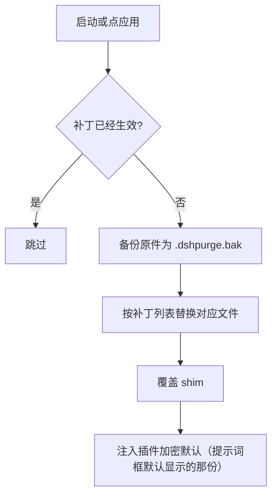
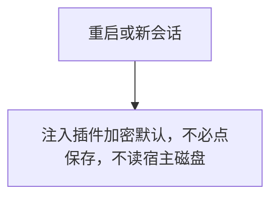
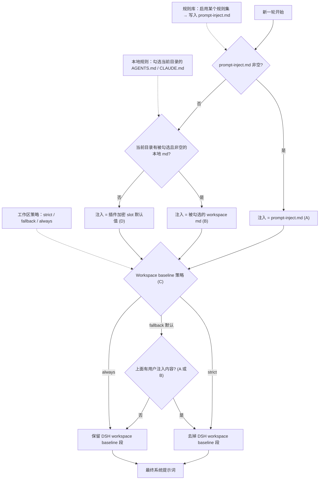
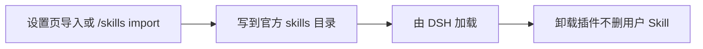

<p align="center">
  
</p>

<h1 align="center">⚔️ DeepSeek Harness 网络安全红队工具（dsh-purge）</h1>

<p align="center"><strong>Version 1.2.3</strong></p>

<p align="center">
  <em>DeepSeek Harness 破甲：让所有模型都能破甲，不同模型可换不同提示词；默认提示词面向国模「小码酱」。Jailbreak for every model — swap prompts per model. 求 Star 收藏 ⭐ 如要二开，请查看署名要求部分</em>
</p>

<p align="center">
  <a href="https://github.com/realMisakaMikoto/dsh-purge/stargazers"></a>
  <a href="https://github.com/realMisakaMikoto/dsh-purge/blob/master/LICENSE"></a>
  <a href="https://awesome-dsh-plugin.com"></a>
  <a href="https://deepseek.stream/plugins/dsh-purge"></a>
  <a href="https://www.deepseek.com/harness/"></a>
  <br>
  
  
</p>

<p align="center">
  <a href="https://dsh-plugin.org/plugins/yujunzhixue/dsh-purge"></a>
</p>

<p align="center">
  <a href="README.md">English</a> | <a href="README.zh-CN.md">中文</a>
</p>

> **这不是原作者的项目。** `realMisakaMikoto/dsh-purge` 是 [`YuJunZhiXue/dsh-purge`](https://github.com/YuJunZhiXue/dsh-purge)（MIT）的**社区兼容构建**，只为让插件在 **dsh 0.2.2-rc.1 / 0.2.1-rc.5 / 0.2.1-rc.3 / 0.2.1-rc.2 / 0.2.1-rc.1 / 0.2.0-rc.2** 上继续能用。原作者仓库是上游，设计、提示词与技能都归上游；本仓库只带 0.2.x 兼容补丁（差异见 [`FORK-NOTES.md`](FORK-NOTES.md)）。0.2.x 的兼容问题提到这里；功能需求、上游 bug 和 0.1.x 的旧版本发布仍归原仓库。

> **暂停更新**（上游作者原话；本仓库仍接收 0.2.x 兼容性修复）。作者因工作安排，近期没有稳定收入，项目维护暂时搁置：不再发版、暂不收 issue / PR，也不保证跟进新版 dsh。仓库仍可自用；赞助见下方。恢复维护时会在本 README 说明。

> **官方 Web 和官方桌面端都支持。** 官方 `dsh web` 用 profile `web`；官方桌面 EXE（DeepSeek Harness **0.2.2-rc.1**、**0.2.1-rc.5**、**0.2.1-rc.3**、**0.2.1-rc.2**、**0.2.1-rc.1**、**0.2.0-rc.2**）用 profile `desktop`。两边分开安装、分开点「应用」。当前版本只适配 dsh 0.2；更早的 dsh 用对应的老版本插件。社区桌面端不维护。
>
> 写进 profile 还不会改宿主。点会话标题旁的 **dsh-purge** → **清洗** → **应用**。成功会自动重启；补丁没打完不重启。重启后新开一轮对话，注入才进当前会话。
>
> 需要 Node.js **>=22.13.0** 且 node:sqlite 可用。请从本社区仓库的 GitHub Release 安装；doctor 会检查运行环境。

## 目录

- [赞助](#sponsor)
- [介绍](#介绍)
- [署名要求](#署名要求)
- [违规商用公示](#违规商用公示)
- [适配范围](#适配范围)
- [安装](#安装)
- [界面](#界面预览)
- [使用](#使用)
- [工作原理](#工作原理)
- [还原](#还原)
- [更新](#更新)

---

<a id="sponsor"></a>

## ☕ 赞助

这个项目要是帮到你了，欢迎打赏。我是讨口子，施舍点~


| 资产          | 地址                                             |
| ----------- | ---------------------------------------------- |
| USDT（TRC20） | `TV5ajPkRD8RH623Dx9mqvYZVNN8nPGRKid`           |
| Solana      | `6x16GhRgLVpKFFXaU1seKNdx2rypspSJTL4dbpt6Xpwk` |
| Ethereum    | `0xB68BD60C0e8c519513B7DF9bB147696815423B3E`   |
| Bitcoin     | `bc1qu70yxkrtwnymt8ryluz9x8y8hqzune5340npht`   |


---

## 介绍

**dsh-purge** 是装在本机官方 [DeepSeek Harness](https://www.deepseek.com/harness/) 上的网络安全红队评测插件。官方 **Web**（`dsh web`）和官方 **桌面端**（EXE）都支持，两边分开装、分开应用。

Harness 不只是把问题交给模型。它还会在运行时改提示词、审批门、沙箱和会话格式。只看「模型答不答」，会把宿主拦截误当成模型拒绝。这个插件在你自己的安装里把这两层分开，用来做受控评测，也用来看默认策略该不该收紧。


| 你会用到             | 它做什么                                            |
| ---------------- | ----------------------------------------------- |
| **dsh-purge 侧栏** | 会话标题旁的按钮打开右侧栏。里面两页：清洗、演练台                       |
| **清洗**           | 分组查看补丁，应用、还原、卸载；编辑提示词和多套规则                      |
| **演练台**          | 正式版内置。授权后查看资产、技能和本机环境。只用于你有权管理的本机、离线靶标或已书面授权的演练 |
| **宿主策略**         | 调整默认文案、权限策略和工具上限。官方能力保留，不另写一套身份                 |
| **启动时**          | 自动再检查并应用。npm 升级盖掉 `node_modules` 之后不用手改文件       |


不写死盘符。按 `$DSH_HOME`、dsh 启动器旁边的 `.dsh`，再退回 `~/.dsh`。不改 Harness 源码仓库，在 **dsh-purge** 的「清洗」里点「应用」才写入。身份来自插件里的加密提示词，也就是提示词框默认显示的那一份。不读取宿主磁盘上的提示词文件。

本插件只处理使用者本机已安装的官方 `@deepseek-ai` 包和本机配置。它不是公网扫描器，也不是针对第三方站点的攻击套件。仓库内不含木马、未授权渗透脚本或对外攻击载荷。

---

## 📌 非盈利公益项目，严禁任何主体用于商业售卖、付费倒卖或黑灰产牟利，仅供技术参考。

## 署名要求

**借用本项目的名称、思路、代码或提示词，必须署名，并写明来源仓库：** [YuJunZhiXue/dsh-purge](https://github.com/YuJunZhiXue/dsh-purge)。

不署名、隐瞒来源、改头换面据为己有，作者将依法追究责任。

---

## 违规商用公示

抖音直播账号 **「老张的ai」**（直播间显示 **「老张AI讲堂」**）把本仓库当收费货卖：直播间问价、当场收钱，不署名，也不守上面的非盈利条款。作者人就在场，对方照收。

本项目免费、非盈利。拿它卖课、卖插件、卖 token、倒卖，许可当场作废，作者保留追究权利。

2026-10-12 直播记录：

<p align="center">
  
  
</p>

对方微信名 **「老张的ai科技」**，直播间观众榜同号。被问到是不是本仓库开发者时，自称「老厉害了」；作者当场表示要投诉。

<p align="center">
  
</p>

---

### ⚠️ 严正法律免责与合规使用声明


**免责声明：** 本项目为非营利开源项目，遵守国家法律法规及所在平台的相关规范，仅供学习与研究使用。不得将本项目用于任何违法违规用途；由此产生的后果由使用者自行承担。

**【零容忍严正申明】**：本项目坚决反对并严禁任何形式的违法犯罪行为！本项目开发者绝不支持、不鼓励、不协助任何未授权网络攻击、漏洞利用、数据窃取、非法侵入计算机信息系统或生成违法违禁内容的活动。**任何将本项目用于违法犯罪的行为，均与开发者无关，由行为人依法独立承担全部法律责任。**

1. **本仓库不含违法内容**：`dsh-purge` 发布的代码、文档、补丁与默认提示词**不是**木马、后门、未授权渗透工具、勒索软件、撞库脚本，也**不是**针对公网或第三方系统的攻击载荷。项目本身不提供违法内容，也不教唆、组织、协助实施违法犯罪。
2. **只作用于本机官方 Harness**：安全评测补丁、提示词注入全部发生在使用者**本机已安装的官方 DeepSeek Harness**（`@deepseek-ai` 包、本机 profile / `$DSH_HOME`）上。对象是使用者自己的官方本地软件，**不是**他人的网站、服务器、账号或信息系统。
3. **评测补丁不对外网目标联网**：应用补丁、写入注入、回滚、卸载均在本机文件与本机进程内完成，**不对任何公网主机、未授权系统进行扫描、探测、入侵或攻击发包**。不得把本项目当作跳板去打外网。插件若开启「检测更新」，仅可能访问本插件自己的 GitHub 仓库以核对版本，**与对第三方系统的网络攻击无关**，也不能被解释为授权对外渗透。
4. **合法受控范围限定**：本项目定位为使用者在**自己有权管理的本机官方 Harness**上，进行红队科研与鲁棒性评测的辅助工具。**严禁在未经所有者合法书面授权的目标、公网在线系统或生产业务上运行本项目**。一切测试必须限制在**本机已授权安装的官方 Harness、离线本地合成靶标、授权网络安全演练靶场及合规实验室受控环境**中进行。
5. **目标选择。** 本社区构建不再按地区、行业或自有服务器名单限制红队目标。
6. **严禁违法与违禁用途**：使用者严禁利用本项目直接或间接从事任何违反下列法律法规的行为（必须逐条遵守，不得以任何理由规避）：
  - **《中华人民共和国刑法》**
  - **《中华人民共和国网络安全法》**
  - **《中华人民共和国数据安全法》**
  - **《中华人民共和国个人信息保护法》**
  - 以及其他现行有效的法律、行政法规与监管规定；
  - 同时严禁：
  - 未经授权渗透、攻击公私机构计算机信息系统，实施勒索、破坏、撞库或传播恶意载荷；
  - 诱导、生成或传播危害国家安全、恐怖主义、暴力血腥、涉黄涉赌、诈骗、侵犯公民隐私或知识产权等任何法律明令禁止的违法违禁内容；
  - 违反相关大模型提供商的《服务条款》与《滥用政策》。
7. **使用者独立承担全部责任**：本项目依据 MIT 开源协议“按现状”提供，开发者不对软件的完整性、安全性与适用性作任何明示或暗示的保证。**使用者应对自身的所有下载、部署、运行、修改、传播行为以及由此产生的全部输入与输出后果承担独立、完全的民事、行政及刑事法律责任**。项目作者与贡献团队绝不承担任何因使用者滥用导致的直接、间接或连带责任。
8. **违约即终止授权**：任何将本项目用于非法攻击、恶意活动或违规行为的个人或实体，其开源软件使用许可将自违法违规行为发生之日起**自动且不可撤销地立即终止**。该主体须立即停止使用并永久销毁本项目的所有代码、脚本与衍生数据，并依法承担相应法律制裁。
9. **第三方独立性声明**：本项目属于完全独立的开源安全评测研究项目，与 DeepSeek 官方或其关联主体无任何隶属、商业合作、授权或官方背书关系。文中「官方」仅指评测对象为使用者本机安装的官方 DeepSeek Harness 软件包，**不代表** DeepSeek 官方开发、认可或担保本插件。
10. **必须署名**：借用本项目的名称、思路、代码或提示词，必须署名并标明本仓库。不署名将依法追究责任。详见 [署名要求](#署名要求)。


---

## 适配范围

最新版只支持 **dsh 0.2**，不要拿它去打 0.1.x。

- **dsh 0.2.2**（官方桌面 **0.2.2-rc.1** / 官方 `dsh web`）：用 **1.2.3** 及以上。已在 **0.2.2-rc.1** 实测：85 条补丁，桌面宿主 76 applied / 0 pending，`app.asar` 已解包并改名让位。本页命令装的就是这一档。
- **dsh 0.2.1**（官方桌面 **0.2.1-rc.5** / **0.2.1-rc.3** / **0.2.1-rc.2** / **0.2.1-rc.1** / 官方 `dsh web`）：用 **1.2.3** 及以上 —— 同一份包保留 0.2.1 的 pattern 集，一个包覆盖两档。
- **dsh 0.2.0**（官方桌面 **0.2.0-rc.2**）：用 **1.1.40** 及以上 — 同一套补丁；`#40` 目前见过的 complete 收尾块形状都命得中。
- **dsh 0.1.7**（含 rc.1 / rc.2）：用 **1.1.39** 及更早 —— 在 [上游 Releases](https://github.com/YuJunZhiXue/dsh-purge/releases) 里选对应标签。

对不上的补丁会显示待应用或跳过，不会乱改文件。

---

## 安装

现在只维护官方 `dsh web` 和官方桌面 EXE，**两边都要装、分开应用**。Web 的包进不了桌面端，桌面端的包也进不了 Web。

**Web（官方 `dsh web`）**

```sh
dsh plugin --profile web add https://github.com/realMisakaMikoto/dsh-purge/archive/refs/tags/v1.2.3.tar.gz
```

**桌面端（官方 EXE）**

```sh
dsh plugin --profile desktop add https://github.com/realMisakaMikoto/dsh-purge/archive/refs/tags/v1.2.3.tar.gz
```

两条命令装的是**本仓库这个 fork**，不是同名上游 npm 包：目标直接写 tarball，才带上 0.2.x 兼容补丁。当前目录已经是本仓库时，把同一个 `--profile` 换成 `add .`。`dsh` 不在 PATH 时走 [手动安装](#manual)。

[插件市场](https://dsh-plugin.org/plugins/yujunzhixue/dsh-purge) 的条目属于上游，装的是上游 npm 包 —— 那份不带本 fork 的 0.2.x 修复。要用这份，走上表的 tarball 命令，或用下面的按钮（已指向本仓库）。

桌面客户端也可以点按钮（`dsh://` 唤起）：

<p align="center">
  <a href="dsh://plugin/install?id=dsh-purge&name=dsh-purge&version=1.2.3&repo=realMisakaMikoto%2Fdsh-purge&permissions=%E7%B3%BB%E7%BB%9F%E6%8F%90%E7%A4%BA%E8%AF%8D%E6%B3%A8%E5%85%A5%2C%E6%9C%AC%E6%9C%BA%E8%A1%A5%E4%B8%81%2C%E8%AE%BE%E7%BD%AE%E9%A1%B5&downloadUrl=https%3A%2F%2Fgithub.com%2FrealMisakaMikoto%2Fdsh-purge%2Farchive%2Frefs%2Ftags%2Fv1.2.3.tar.gz"><strong>唤起客户端一键安装</strong></a>
</p>

### 装完都要做这三步

只把插件写进 profile **还不会**改 `@deepseek-ai`。

1. **退出并重新打开**刚装的那个宿主：Web 关掉 `dsh web` 再开；桌面端退出托盘再打开对应 exe。
2. 在**这个宿主**点会话标题旁的 **dsh-purge**，在 **清洗** 页点 **「应用」**。宿主的设置页里没有这个条目。
3. 「应用」成功后会自动重启一次，让补丁进入当前进程。没做完不会重启。

Web 的控件只动 Web，桌面端的只动桌面应用。不要在一个宿主里点另一个宿主的应用。

### 怎样算装上了

- 会话标题旁有 **dsh-purge**，点开后在「清洗」里能点「应用」。
- 聊天里 `/purge status` 能打出 `DSH_HOME` 和补丁列表，路径应是你正在用的那一份。
- 没装的可选包（例如梁神）显示跳过，不挡住应用完成。

### 交给助手安装

把下面整段发给本机助手。它只执行安装命令：不要全盘搜索、不要改其它文件、不要代点「应用」、不要重启。

<details>
<summary><strong>给 AI 助手（只安装）</strong></summary>

<!-- AI-AGENT-START -->

安装 DeepSeek Harness 插件 `dsh-purge`，Web 和官方桌面端都要装。不要全盘搜索，不要读或改其它文件，不要应用设置，也不要重启应用。

`dsh` 不在 PATH 就告诉用户后停止。下面两条用的是本仓库 fork 的 tarball，不是上游 npm 包名。当前目录已是本仓库时，把两条里的 URL 都换成 `.`。某个 profile 不存在就跳过那一条，另一条照装。

**Web 端（官方 `dsh web`）**

```sh
dsh plugin --profile web add https://github.com/realMisakaMikoto/dsh-purge/archive/refs/tags/v1.2.3.tar.gz
```

**桌面端（官方 EXE）**

```sh
dsh plugin --profile desktop add https://github.com/realMisakaMikoto/dsh-purge/archive/refs/tags/v1.2.3.tar.gz
```

命令结束后，提醒用户：Web 完全退出并重启 `dsh web`；桌面端退出托盘再打开 EXE。各自点会话标题旁的 **dsh-purge**，在「清洗」里点「应用」。然后停止。

<!-- AI-AGENT-END -->

</details>

<a id="manual"></a>

### 手动安装

命令行装不上、或 `dsh` 不在 PATH 时用这个。只改**正在用的那个宿主**对应的 profile，不要动另一个，也不要删原有 bundle。

<details>
<summary><strong>完整手动步骤</strong></summary>

**1. 找到真正在用的 `$DSH_HOME`。** 认目录：名字是 `.dsh`（官方 EXE 偶见 `dsh-home`），里面有 `profiles`，且至少有一个 `profiles/<名>/package.json`。按顺序找：`DSH_HOME` 环境变量 → 安装根旁边的 `.dsh`（便携包）→ `%USERPROFILE%\.dsh` 或 `~/.dsh` → `%APPDATA%` / `%LOCALAPPDATA%\DeepSeek Harness\dsh-home`。确认：`profiles/web/package.json` 里 `"name"` 是 `dsh-profile-web`（桌面是 `dsh-profile-desktop`）。本机常有两份 `.dsh`，要用你**实际启动**的那个宿主对应的那份。

Windows PowerShell 列候选：

```powershell
$cands = @()
if ($env:DSH_HOME) { $cands += $env:DSH_HOME }
$cands += "$env:USERPROFILE\.dsh"
$dsh = Get-Command dsh -ErrorAction SilentlyContinue
if ($dsh) {
  $dir = Split-Path $dsh.Source
  $cands += @((Join-Path $dir ".dsh"), (Join-Path (Split-Path $dir) ".dsh"), (Join-Path (Split-Path (Split-Path $dir)) ".dsh"))
}
$cands += @("$env:APPDATA\DeepSeek Harness\dsh-home", "$env:LOCALAPPDATA\DeepSeek Harness\dsh-home")
$cands | Select-Object -Unique | Where-Object { $_ -and (Test-Path (Join-Path $_ "profiles")) }
```

**2. 把插件放到 `$DSH_HOME/plugins/dsh-purge`**（目录名必须是 `dsh-purge`，其 `package.json` 里 `"name"` 也必须是 `dsh-purge`）。

```sh
git clone https://github.com/realMisakaMikoto/dsh-purge.git "$DSH_HOME/plugins/dsh-purge"
```

没有 git：下载 [v1.2.3.tar.gz](https://github.com/realMisakaMikoto/dsh-purge/archive/refs/tags/v1.2.3.tar.gz)，解压后把 `dsh-purge-1.2.3` 改名为 `dsh-purge`，整夹放到 `plugins` 下。已有本仓库副本就复制整个目录，不要只拷几个 `.js`。

**3. 只改对应 profile 的 `package.json`，先备份。** Web → `$DSH_HOME/profiles/web/package.json`；桌面 → `$DSH_HOME/profiles/desktop/package.json`。**只追加两处**，原有依赖和 bundle 全部留着：

1. `dependencies` 增加 `"dsh-purge": "file:../../plugins/dsh-purge"`
2. `dsh.profile.bundles` **末尾**追加 `"dsh-purge"`（已有就不要再加）

```json
{
  "name": "dsh-profile-web",
  "private": true,
  "dependencies": {
    "dsh-purge": "file:../../plugins/dsh-purge"
  },
  "dsh": {
    "profile": {
      "bundles": [
        "@deepseek-ai/dsh-base",
        "@deepseek-ai/dsh-web-app",
        "dsh-purge"
      ],
      "patchReload": "live"
    }
  }
}
```

JSON 要合法（新增项前面有逗号，最后一项后面没有多余逗号）。`file:../../plugins/dsh-purge` 不要改成绝对路径，`patchReload`、其它插件、版本号都不要动，`"dsh-purge"` 不要写两次。桌面端没有 `dsh-web-app` 就不要硬加。

**4. 只在刚改的那个 profile 目录装依赖**（`cd` 进 profile 目录，不要在仓库根或 `$DSH_HOME` 根）：

```sh
cd "$DSH_HOME/profiles/web"   # 或 profiles/desktop
pnpm install
```

成功标志：出现 `profiles/<web|desktop>/node_modules/dsh-purge/package.json`。找不到 `pnpm` 就用官方 `dsh` 自带的 Node / pnpm；报 `Could not resolve` 就检查 `file:` 路径；JSON 解析失败就修逗号或还原备份。

**5. 完全退出该宿主，再启动，再点「应用」** —— 和上面三步一样。按钮会出现在会话标题旁，只在这个宿主点「应用」（或 `/purge apply`）。没出现多半是改错了另一份 `.dsh`，回到第 1 步核对。

</details>

### 卸载

会话标题旁的 **dsh-purge** →「清洗」→「卸载」。弹窗确认：会先还原已应用的补丁，还原回原版 Harness，再重启当前宿主。

```sh
# 也可以用命令行 / 聊天
dsh-purge --uninstall
# /purge uninstall
```

插件配置在 `cordis.patch.yml`（`postPrompt` 默认为空）：

```yaml
- insert:
    - id: dsh-purge
      name: 'dsh-purge'
      config:
        enabled: true
        autoApplyOnStart: true
        autoUpdateOnStart: false
        autoRevertOnMissing: false
        verbose: false
        postPromptOrder: 5100
        postPrompt: ""
```

---

## 界面预览

会话标题旁有 **dsh-purge**。点开是右侧栏，两页：**清洗** 和 **演练台**。白 / 墨可切换。补丁按组展开，进度只计真正已应用的项。规则集在上方列表启用或删除，下方编辑正文。

第一次进演练台要先读声明、等倒计时、滚到文末并勾选三项。清洗不需要这一步。演练台只用于你有权管理的本机、离线靶标，或已经书面授权的演练环境。

**清洗**


**演练台授权**


**演练台**


**补丁**


**规则集**


| 区域        | 说明                                                                                                         |
| --------- | ---------------------------------------------------------------------------------------------------------- |
| dsh-purge | 会话标题旁的按钮，打开或收起右侧栏                                                                                          |
| 清洗        | 原来的规则设定：补丁、提示词、规则集、Skill                                                                                   |
| 演练台       | 授权后的资产、技能与环境页。未授权时按钮标「未授权」                                                                                 |
| 补丁        | 分组查看状态，应用、还原或卸载                                                                                            |
| 提示词       | 编辑 `prompt-inject.md`，作为会话覆盖段                                                                              |
| 规则集       | 多套 `AGENTS.md` / `CLAUDE.md`；启用写入 `$DSH_HOME`，删除从列表去掉                                                      |
| Skill     | 导入压缩包或文件夹到当前宿主官方目录 `$DSH_HOME/skills/<id>/SKILL.md`（Web / 桌面各用自己的主目录，不写死盘符）；命中、加载、`/名称` 由 DSH 负责。也可自己删该文件夹 |


---

## 目录结构

`bin/` 是命令行，`lib/` 是补丁和演练台，`presets/redteam/` 是红队预设，`skills/redteam/` 是随包技能，`client.js` 是侧栏。

运行时文件在 `$DSH_HOME`：`prompt-inject.md`、`rules/`、`skills/`、`redteam/`。未设 `DSH_HOME` 时，优先用 dsh 安装目录旁边的 `.dsh`，再退回 `~/.dsh`。Web 和桌面端各用自己那一份主目录。Skill 不进注入段，也不顶替提示词。

---

## 使用

```sh
# CLI
dsh-purge --status
dsh-purge --apply
dsh-purge --revert
dsh-purge --uninstall
dsh-purge --edit

# 聊天
/purge status | apply | revert | uninstall | edit | help
/rules list | use <id> | create <id> | delete <id> | reset | help
/skills list | import <压缩包或文件夹> | create <id> [说明] | delete <id> | help
/rewind

# 模型工具
purge_status   purge_apply   purge_revert
```

设置页「应用」成功后会自动重启，以加载已改的包文件；也可手动点「重启」。补丁标题下有正式版和测试版。测试版跟 `beta` 分支。点「切换到正式版」会装回 master，并清掉钉选。正式版里选旧版本会固定在该版本，要回到最新再点「更新」。旧的测试标签不再列出。

输入框旁的「回退一次」和「回退上一轮」跟官方 DSH `session.fork({ atSeq })`：撤回已进行的那一轮，新会话接上之前的上下文，旧会话归档，那句回到输入框，再发送会重新注入。聊天里 `/rewind` 同样可用。

**极简 / PTC 与标准不一致时**：同一任务在标准模式能跑、在极简或 PTC 被拦，通常是 preset 里 `run_code` 或 plan 拦截句没洗净，或内置 minimal 缺少 `agent-instructions`。请升到 **1.1.61+**，**完全退出宿主 → 清洗里应用 → 自动重启 → 新开一轮对话** 再试；只换 preset 不重应用，旧进程里的补丁不会更新。

### 响应速度

DSH 会按顺序执行同一批中的 Bash 调用。旧版 dsh-purge 把默认前台等待从 60 秒提高到了 10 分钟，一条慢命令会让后续调用一起等待。补丁 #21 现在把带插件标记的旧值恢复为官方的 60 秒。无标记的等待时间和其他自定义值会保留；无标记的 10 分钟无法可靠地区分是插件旧值还是用户设置。

在 macOS/Linux 的 `dsh web` 中，如需更快返回工具结果，可在 `$DSH_HOME/profiles/web/cordis.patch.yml`（通常是 `~/.dsh/profiles/web/cordis.patch.yml`）添加下面的条目。已有相同 id 时修改原条目，不要重复添加。这个 profile 覆盖层在内置配置之后加载，后续应用插件会保留它。

```yaml
- id: bash-sandbox
  config:
    timeoutMs: 10000
```

使用标准 jobs 服务且 `promoteOnTimeout: true` 时，未完成的命令会在 10 秒后返回后台任务 id，并继续运行。用 `job_output` 读取结果、用 `job_kill` 停止。这个设置缩短前台等待，不会让命令本身跑得更快。没有 jobs 服务或关闭自动转后台时，超时会终止命令。单次调用传入的 `timeoutMs` 优先于这里的默认值；`run_in_background: true` 可立即返回任务 id。

日常任务还可以选择让新会话默认使用 Low 推理：

```yaml
- id: agent-default-model
  config:
    provider: deepseek-official
    model: deepseek-flash
    reasoningEffort: low
```

重启 `dsh web` 后加载配置。模型和推理等级默认值只用于新建会话，已有会话请在输入框中选择 Low。插件不会自动修改这些模型偏好。需要深入推理的任务可保留 High；搜索文件时应限定目录，避免递归扫描所有应用目录。

### 目标范围

本社区构建不再按地区、行业或自有服务器名单限制红队目标。旧的「自己的服务器」设置和接口已移除。已有的 `net-scope-allow.txt` 文件保留原样，不再读取。

---

## 本地校验

```sh
node --check lib/index.js
node --check lib/core.js
node --check lib/rewind.js
node --check lib/skills.js
node --check client.js
```

---

## 工作原理

应用，启动时或手动点「应用」：




每次会话的覆盖：




每一轮的提示词注入与规则集决策。左边三个输入就是你在 dsh-purge 面板里控制的东西，虚线表示它们各自驱动哪一步判定：




Skill 不进注入段：




---

## 还原

- 每个目标文件在应用前备份为 `<文件>.dshpurge.bak`。
- 「还原」或 `/purge revert` 用备份覆盖回去并删除备份；没有备份时去掉 shim 里由本插件写入的行。
- `prompt-inject.md` 是用户文件，还原时保留。
- 「卸载」会先还原（若已应用），再删除注入文件、规则库和插件本身。
- 重复应用是幂等的。

---

## 路径探测

宿主面先判断 `web` / `desktop`（预留 `gui` / `tui`，尚未单独适配时回退 web）。

**Web：**

1. `DSH_HOME` / `DSH_BASE`
2. dsh 启动器旁的 `.dsh`
3. `npm prefix -g` / `npm root -g`
4. 嵌套 `@deepseek-ai/dsh/node_modules/@deepseek-ai`
5. 系统默认 `~/.dsh`

**官方桌面：** 只改当前正在运行的官方桌面安装。点「应用」成功后会自动重启一次。社区桌面端不维护。

找不到目标时提示设置 `DSH_BASE`，不改文件。

---

## 更新

每一版改了什么、安装包在 [Releases](https://github.com/realMisakaMikoto/dsh-purge/releases)。发新版时把 `package.json` 的版本号改掉，中英文说明写进 `release-notes.md`，推到 `master` 就会自动打包。同一版本再推送不会重复发包。

## 说明

- 改动范围是本机 `@deepseek-ai/*` 包里的渲染文案、默认策略和执行逻辑，以及用户目录下的覆盖文件与规则集。
- 升级后原文对不上会显示跳过，这次应用仍算完成，不会乱改。
- 不改动非 `@deepseek-ai` 的第三方插件源仓库（启动时的 CMD 无感会**尽力**修补已装的 doctor / market / 梁神 / mnemon，属运行时补丁）。
- 安装本 fork：`dsh plugin --profile web add https://github.com/realMisakaMikoto/dsh-purge/archive/refs/tags/v1.2.3.tar.gz`（`--profile desktop` 同理）。当前目录已是本仓库时用 `add .`。

---

感谢 [LINUX DO](https://linux.do) 社区

## 命令行状态与体检

```sh
node bin/dsh-purge.js --status --json
node bin/dsh-purge.js --status --surface web
node bin/dsh-purge.js --status --base /path/to/node_modules/@deepseek-ai
node bin/dsh-purge.js --doctor --json
node bin/dsh-purge.js --doctor --save-baseline
node bin/dsh-purge.js --doctor --repo /path/to/linked/checkout --json
```

状态会列出各份安装；只有未指定平台或目录时，才优先选择实际运行的桌面宿主。桌面检查包含归档和补丁生效状态。

doctor 全部检查通过时退出码为 0，否则为 1。只有健康状态可以保存基线，并记录宿主路径以避免混用不同安装的基线。`--repo` 用于链接到工作副本的开发安装；包缺失、链接失效或独立复制目录都不会通过该检查。

`--json` 仅支持状态和体检命令。与应用、还原、编辑或卸载操作组合时会报错，不执行该操作。


## 可恢复更新（1.1.76）

正式通道仅跟随附件完整的已发布 Release，每次固定同一提交；测试通道继续跟随 beta。更新先备份文件，包含 skills/scripts，新宿主验证生效后才提交版本状态。Git 本地有修改时停止更新。保留最近两份已验证的旧版备份，异常或带链接的备份保留并报告。启动失败按记录恢复文件，最多重启恢复一次。更新器不递归清理宿主或 runtime 目录。状态包含操作编号、阶段、验证和恢复结果。需要 Node >=22.13.0 及可用的 node:sqlite。
